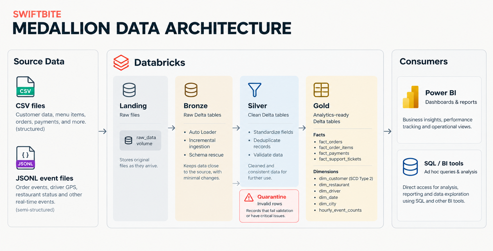

# SwiftBite

SwiftBite is a fictional food delivery platform built as a data engineering project using Databricks.

The project uses synthetic food delivery data to build a data pipeline with a Medallion Architecture. It covers data ingestion, cleaning, validation, event processing and dimensional modelling.

## Architecture



## Dataset

The raw dataset is hosted separately on Kaggle.

- **Dataset:** [SwiftBite Raw Data](https://www.kaggle.com/datasets/nvsirkhvn/swiftbite-raw-data)
- **Size:** Approximately 4.6 GB
- **Formats:** CSV and JSONL
- **Data:** Customers, restaurants, drivers, orders, payments, support tickets, traffic, weather and event records.

All records are synthetic and do not represent real people or transactions.

Download the dataset from Kaggle before running the notebooks.

## Tech Stack

- Databricks Free Edition
- Python
- PySpark
- Delta Lake
- Unity Catalog
- Auto Loader

## Project Structure

```text
SwiftBite/
│
├── assets/
│   └── swiftbite-data-architecture.png
│
├── data-engineering/
│   └── notebooks/
│       ├── 00_databricks_setup.py
│       ├── 01_shared_config.py
│       ├── 02_data_profiling.py
│       ├── 03_bronze_ingestion.py
│       ├── 04_silver_transformation.py
│       ├── 05_event_time_analysis.py
│       ├── 06_scd2_dim_customer.py
│       ├── 07_dimensional_model.py
│       └── 08_gold_performance.py
│
├── docs/
│   ├── project-overview.md
│   ├── pipeline.md
│   ├── data-quality.md
│   ├── data-model.md
│   └── README.md
│
└── README.md
```

## Run Order

1. `00_databricks_setup`: create the catalog, schemas, and volumes.
2. `03_bronze_ingestion`: load raw files into Bronze with Auto Loader.
3. `04_silver_transformation`: clean, deduplicate, quarantine, and write Silver.
4. `06_scd2_dim_customer`: build customer history.
5. `07_dimensional_model`: build dimensions and `fact_orders`.
6. `08_gold_performance`: optimize the fact table and run checks.

`02_data_profiling` and `05_event_time_analysis` are optional exploration notebooks.

Upload the source files to the `swiftbite.landing.raw` volume before running `03`. See the [pipeline guide](docs/pipeline.md) for paths and rerun behavior.

## How the Layers Work

**Bronze**
- Auto Loader reads new files once and stores them as Delta tables.
- Checkpoints remember processed files.
- Unexpected columns go to `_rescued_data` instead of failing the load.

**Silver**
- Deduplicate on the natural key with a deterministic tie-breaker.
- Clean fields such as emails, phones, cities, promo codes, and timestamps.
- Send rejected rows to a quarantine table with a `_reason`, `_run_id`, and timestamp.
- Use `write_silver` to MERGE keyed tables on their natural key.
- Use overwrite for full snapshots such as customers and for small pass-through tables.

**Gold**
- Build dimensions with stable `xxhash64` surrogate keys.
- Add one `-1` unknown member to every dimension used by facts.
- Track customer changes with SCD Type 2: `valid_from`, `valid_to`, `is_current`.
- Build `fact_orders` with one row per order and no null foreign keys.
- Rebuild facts and dimensions from Silver on each run.
- The optional `05_event_time_analysis` notebook adds `gold.hourly_event_counts`.

## Design Decisions

| Decision | Why |
|---|---|
| Auto Loader for Bronze | Processes only new files and keeps ingestion state in a checkpoint. |
| Deduplicate before cleaning | One row per natural key makes validation and MERGE predictable. |
| Quarantine with a reason | Bad rows stay visible and traceable instead of being dropped. |
| MERGE for keyed Silver tables | A rerun updates existing keys instead of inserting duplicates. |
| Overwrite for full snapshots | Customer history must keep every version, so a full rebuild is safer than a key merge. |
| Stable `xxhash64` surrogate keys | The same natural key gives the same key after a rerun. `monotonically_increasing_id()` is not stable. |
| `-1` unknown members | Every fact foreign key resolves to a real dimension row. |
| SCD2 for customers | City, segment, payment method, and account status changes are tracked over time. |
| No partitioning | The dataset is small. Partitioning would create many small files; `OPTIMIZE ZORDER` handles file layout. |
| Full rebuild for facts | Facts are derived from Silver and small enough to rebuild. It is simpler and still idempotent. |

## What to Check After a Run

- `silver.orders` has one row per order.
- `gold.fact_orders` has the same row count as `silver.orders`.
- Every fact key is either a real dimension key or `-1`.
- Rerunning `04`, `06`, and `07` leaves row counts and surrogate keys stable.

## Example Queries

Revenue by city:

```sql
SELECT ci.city_name, ROUND(SUM(f.total_amount), 2) AS revenue
FROM swiftbite.gold.fact_orders f
JOIN swiftbite.gold.dim_city ci ON f.city_sk = ci.city_sk
GROUP BY ci.city_name
ORDER BY revenue DESC;
```

Top restaurants by revenue:

```sql
SELECT r.restaurant_name, COUNT(*) AS orders, ROUND(SUM(f.total_amount), 2) AS revenue
FROM swiftbite.gold.fact_orders f
JOIN swiftbite.gold.dim_restaurant r ON f.restaurant_sk = r.restaurant_sk
GROUP BY r.restaurant_name
ORDER BY revenue DESC
LIMIT 10;
```

`06_scd2_dim_customer` displays one customer's version history at the end of the notebook.

## Limitations

- `fact_order_items`, `fact_payments`, and `fact_support_tickets` are pass-through tables. They are not joined to dimensions yet.
- `dim_city` is a small hardcoded list. Cities outside the list resolve to `-1`. A real project would load the list from a reference table.
- Keyed Silver tables use MERGE. If a row that was valid becomes invalid, the old Silver row remains until Silver is rebuilt. The current dataset is append-only, so this does not happen in practice.
- SCD2 collapses multiple customer rows with the same `customer_id` and `signup_timestamp` to the latest ingested copy. The first version starts at midnight of the signup date so same-day orders can resolve.
- `fact_orders` is rebuilt in full on each run. That is deliberate at this data size, not an incremental fact load.
- The notebooks are run by hand in order. There is no orchestrator, scheduler, or CI.

## Documentation

- [Project Overview](docs/project-overview.md)
- [Pipeline Guide](docs/pipeline.md)
- [Data Quality](docs/data-quality.md)
- [Data Model](docs/data-model.md)

---

*SwiftBite is a portfolio project built with synthetic data for learning and demonstrating data engineering workflows.*