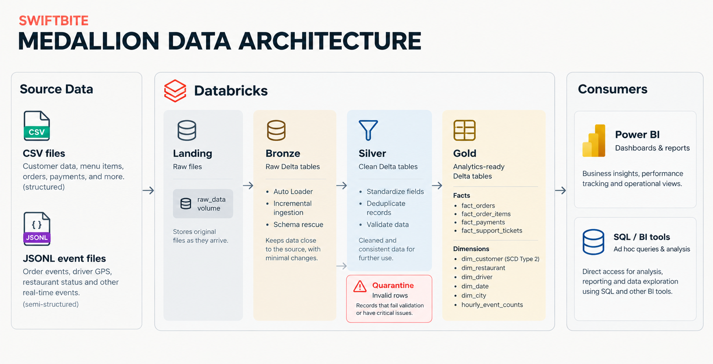

# SwiftBite

SwiftBite is a fictional food delivery platform built as a data engineering project using Databricks.

The project uses synthetic food delivery data to build a data pipeline with a Medallion Architecture. It covers data ingestion, cleaning, validation, event processing and dimensional modelling.

## Architecture



## Dataset

The raw dataset is hosted separately on Kaggle.

- **Dataset:** [SwiftBite Raw Data](https://www.kaggle.com/datasets/nvsirkhvn/swiftbite-raw-data)
- **Size:** Approximately 4.6 GB
- **Formats:** CSV and JSONL
- **Data:** Customers, restaurants, drivers, orders, payments, support tickets, traffic, weather and event records.

All records are synthetic and do not represent real people or transactions.

Download the dataset from Kaggle before running the notebooks.

## Tech Stack

- Databricks Free Edition
- Python
- PySpark
- Delta Lake
- Unity Catalog
- Auto Loader

## Project Structure

```text
SwiftBite/
│
├── assets/
│   └── swiftbite-data-architecture.png
│
├── data-engineering/
│   └── notebooks/
│       ├── 00_databricks_setup.py
│       ├── 01_shared_config.py
│       ├── 02_data_profiling.py
│       ├── 03_bronze_ingestion.py
│       ├── 04_silver_transformation.py
│       ├── 05_event_time_analysis.py
│       ├── 06_scd2_dim_customer.py
│       ├── 07_dimensional_model.py
│       └── 08_gold_performance.py
│
├── docs/
│   ├── project-overview.md
│   ├── pipeline.md
│   ├── data-quality.md
│   ├── data-model.md
│   └── README.md
│
└── README.md
```

## Pipeline

The project follows three main processing stages:

**Bronze**
- Ingest raw CSV and JSONL data.
- Use Auto Loader for incremental ingestion.
- Handle schema changes.

**Silver**
- Clean and standardize records.
- Remove duplicates.
- Validate data and separate invalid records into quarantine.
- Handle event timestamps.

**Gold**
- Build fact and dimension tables.
- Maintain customer history using SCD Type 2.
- Prepare data for analytics and reporting.

## Running the Project

1. Download the dataset from Kaggle.
2. Set up the Databricks environment.
3. Upload the source files to the `swiftbite.landing.raw_data` volume.
4. Open the notebooks in `data-engineering/notebooks`.
5. Run them in numerical order, starting with `00_databricks_setup.py`.

See the [pipeline documentation](docs/pipeline.md) for more details.

## Documentation

- [Project Overview](docs/project-overview.md)
- [Pipeline](docs/pipeline.md)
- [Data Quality](docs/data-quality.md)
- [Data Model](docs/data-model.md)

---

*SwiftBite is a portfolio project built with synthetic data for learning and demonstrating data engineering workflows.*